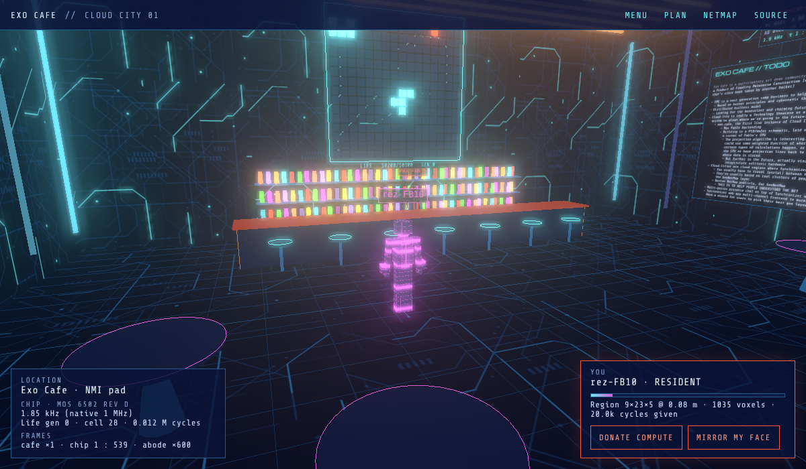
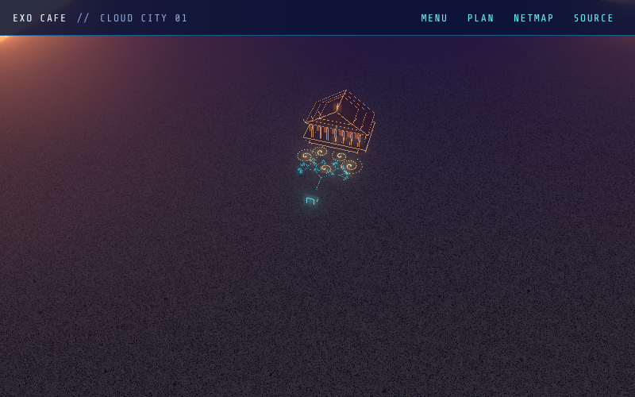
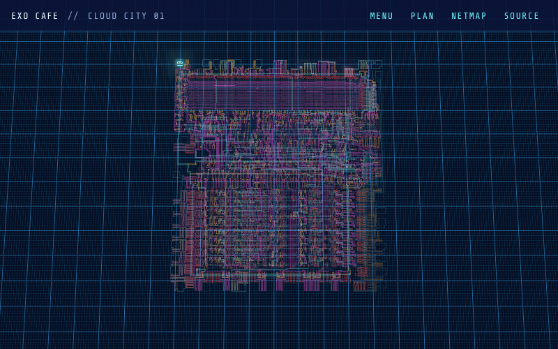
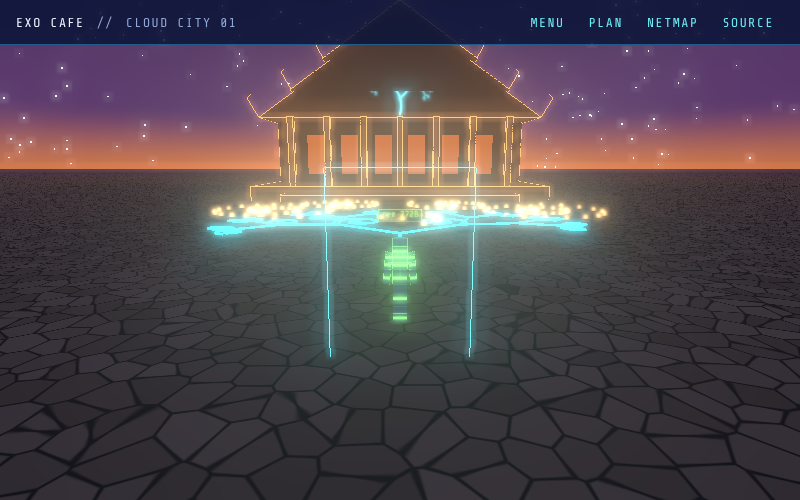

# Exo Cafe

**A Tron bar on the NMI pad of a running 6502.** The first live instance of
Cloud City, a platform by Freality Metaverse Construction (FMC), prototyped
by the community that gathers at [exo.cafe](https://exo.cafe).



- **The street is the chip.** Walk out the door and you're on a metal trace
  of a MOS 6502, laid out from [visual6502](http://www.visual6502.org)'s
  netlist at 0.1 m per layout unit. Zoom out and the city is the whole die,
  about 900 m across. Every polygon is lit by its node's voltage.
- **The chip is really running.** A switch-level simulation of all 3,510
  transistors runs in a Web Worker. Its program is Conway's Game of Life,
  in 6502 assembly ([life.js](src/chip/life.js)).
- **The bar follows the buses.** Eight light tubes are the data bus, sixteen
  across the ceiling are the address bus, and the counter's edge is the
  clock. The wall behind the bar is the Life board in RAM, lit cell by cell
  as the CPU writes it. Click a cell to poke memory.
- **Every place keeps its own time.** The chip runs at a few kHz against its
  native 1 MHz, about 1 : 500 in bar time. Through the arch in the west wall
  is Pablo's abode, where the sky turns 600 times faster than the bar's.
  [cosmic.js](src/cosmic/frames.js) does the reprojection between frames.
- **Rez is earned.** Guests rez in voxels (0.16 m, the minecrafty body).
  Donate compute to the shared simulation and your body re-voxelizes
  finer, until it's smooth.
- **Your face, your avatar.** *Mirror my face* runs MediaPipe's face
  landmarker in your browser and draws your face on your visor; your head
  turns its head. Video never leaves your machine.
- **Out the door, the Grid.** A gate on the street jacks you into
  [NetMap](https://pablo-mayrgundter.github.io/netmap/), maps of the
  internet you can travel.

| The street, from 100 m | The die, from orbit | Pablo's abode |
|---|---|---|
|  |  |  |

The original fever dream, and the principles behind it, are in
[docs/VISION.md](docs/VISION.md). What's built and what's next, organized
as Initiative › Epic › Story › Task with cross-cutting Technology Tracks, is
in [docs/PLAN.md](docs/PLAN.md).

## Run it

```sh
npm install
npm run dev        # http://localhost:5173
npm test           # assembler, chip (one Life generation, ~15 s), frames, ledger
npm run build      # → dist/, deployable as static files
```

Controls: WASD or arrows to walk, Shift to run, drag to look, wheel or
pinch to zoom out over the die. On touch screens, drag the left half to walk.
Enter chats; E at the gate jacks into NetMap. `?fx=0` turns off bloom,
`?enter` skips the intro, and `?debug` exposes `window.exo` for poking at
the scene from the console.

Pushes to `main` deploy to exo.cafe from the `gh-pages` branch; each pull
request gets a preview at `https://exo.cafe/pr-preview/pr-<n>/`.

Open two tabs to see presence: they share a room over `BroadcastChannel`
until the Synchronizer (Matrix and murmur) replaces it.

## Layout

| Path | What |
|---|---|
| [src/chip/](src/chip) | the 6502: switch-level sim (`sim.js`), assembler, Life program, worker |
| [src/world/](src/world) | the chip as a city floor, the bar, the abode, portals, textures |
| [src/avatar/](src/avatar) | voxel and smooth avatars, face tracking |
| [src/cosmic/](src/cosmic) | frames of space and time |
| [src/mist/](src/mist) | the ledger: donated compute → rez |
| [src/net/](src/net) | presence, behind a transport interface |
| [public/chip/6502.json](public/chip) | the netlist and layout, from `scripts/import-visual6502.mjs` |
| [docs/](docs) | vision and plan |

## Credits and licenses

Code: MIT ([LICENSE](LICENSE)). The simulator is a port of visual6502's
MIT-licensed `chipsim.js` and agrees with it node for node.

The 6502 layout and netlist are © 2010 Greg James, Brian Silverman and
Barry Silverman, under **CC BY-NC-SA 3.0**
([public/chip/LICENSE.md](public/chip/LICENSE.md)): fine for this
non-commercial art demo, but anything commercial built on Cloud City needs
another chip or their permission (see the plan's open questions).

The bar's look borrows the palette and type of
[pablo-mayrgundter.github.io](https://pablo-mayrgundter.github.io), with
nods to Tron, Neal Stephenson's Metaverse and Ready Player One.
